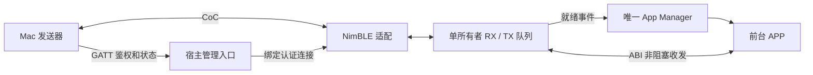

# ABI 2.2：单所有权 L2CAP CoC

2026-10-27：宿主、photoframe v20 和 Mac 发送端已部署；一次67,509字节CoC发送耗时2.477秒，并在01:49:21（UTC+8）取得物理完成回执。源码发布和长期验证范围见项目Wiki状态页。按用户要求未新增测试用例、未运行全面测试。

## 归属与架构

唯一前台 APP 通过 `APP_MANIFEST_COC` 声明 ABI 2.2。全局只有一个 CoC 注册和一个连接，自动归属当前运行代次，不提供多应用 socket 表。原 ABI 1/2.0/2.1、目录、按键切换和 GATT 管理协议继续保留。



原件为 `sdk/photopainter_app.h`、`sdk/abi2_imports.inc`，应用仓库保存相同副本。CoC 导入只允许 minor >= 2；旧宿主在加载前拒绝 2.2 应用。

## 接口

```c
int32_t app_host_coc_open_v22(const app_coc_config_v22_t *config);
int32_t app_host_coc_info_v22(app_coc_info_v22_t *info);
int32_t app_host_coc_recv_v22(uint32_t session, void *dst,
                            uint32_t capacity, uint32_t *received);
int32_t app_host_coc_send_v22(uint32_t session, const void *src,
                            uint32_t bytes);
int32_t app_host_coc_close_v22(void);
```

- 仅在当前 APP 事件内调用。STOP 只允许查询/关闭。
- config 为 16 字节；`rx_sdu_bytes` 为 128–4096，`rx_slots/tx_slots` 为 1–8。photoframe 采用 4096/4/4，应用队列约 32 KiB，另计 NimBLE mbuf 池和协议缓冲。
- info 为 24 字节，state：0 关闭、1 等待、2 连接；包含 PSM、session、双方最大应用记录长度。PSM 固定 `0x81`。
- `APP_EVENT_COC=7`，旧 context/result/manifest 布局不变；事件数据为 24 字节，type 是 CONNECTED、DISCONNECTED、RX_READY、TX_READY、ERROR 位集。
- 数据就绪事件合并；连接边界撤销旧数据。最新 CONNECTED 也要求 APP 清理旧接收状态。
- recv 一次消费一条完整应用记录；TOO_SMALL 返回所需长度且不消费。send 成功表示复制入队，调用方可复用源缓冲，不表示远端业务完成。
- I/O 状态：OK=0、AGAIN=1、CLOSED=2、STALE=3、TOO_SMALL=4、BUSY=5；参数/上下文错误沿用负数 APP 错误。正数 I/O 状态不能直接传给 `app_complete`。
- disconnect 清空连接队列、保留前台注册；close/切出/卸载撤销归属并释放缓冲。所有跨边界对象都是宿主副本，旧 session 不能操作新连接。

## 无线封套

Mac 先完成现有 GATT 双向 HMAC 鉴权，再从签名状态取得 `coc_version=1`、`coc_psm`、generation。CoC 仅接受同一已认证 GAP 连接。服务端无线 MTU 为 4096，APP 可通过 hello 声明更小的接收预算。CoreBluetooth 暴露字节流，宿主增量解析长度，不假设一次 stream write/read 等于一个 SDU。

整数均为 little endian。82 字节 hello：

| 偏移 | 内容 |
|---|---|
| 0 | u16=80，后续长度 |
| 2 | 四字节 `PPC1` |
| 6 / 10 | u32 APP generation / 非零 CoC session |
| 14 / 16 | u16 服务端接收/发送的最大应用记录长度 |
| 18 | 新随机 nonce，32 字节 |
| 50 | HMAC-SHA256(GATT session key, `pp-coc-v1/hello` + hello[2:50]) |

方向密钥为 HMAC-SHA256(GATT session key, `pp-coc-v1/c2s` + nonce) 与对应的 `pp-coc-v1/s2c`。APP 不接触密钥。

数据记录：`length:u16 | sequence:u32 | payload | tag:32`。length 不含自身；每方向 sequence 从 1 递增；tag 用方向密钥覆盖 sequence 和 payload。封套开销 38 字节，4 KiB 预算对应最大 payload 4058 字节。错误长度、序号、tag 或失效所有者会断开通道。提供鉴权和完整性，未增加内容加密。

## 背压与生命周期

宿主不解析 PNG。RX 队列满时不供应下一份接收 mbuf，APP 消费后恢复；TX credits 不足时等待 TX_UNSTALLED，不重发已接纳 SDU。适配代码按固定 IDF 的 mbuf 所有权规则处理成功、ESTALLED、EBUSY 及错误。

photoframe 每个事件最多处理四条记录。纯数据事件不扫描全部 Flash 槽，显示仍走既有同步服务和 650 秒预算。CoC 空闲超过 60 秒且 Manager 未执行事务时断开；连接存续期间保持 GATT 空闲计时活跃，既有会话总时限仍有效。

实现：`app_coc.c` 管单所有权/队列；`ble_coc.c` 管 NimBLE、封套与流控；`app_services.c` 检查调用上下文；`app_manager.c` 统一调度。

## 部署边界

需要先更新宿主 factory，再安装 ABI 2.2 APP。APP 独立打包，不能把 photoframe 构建生成的辅助 firmware bin 当作宿主烧录。部署仍使用既有完整 Flash 备份、精确端口和只写 factory 的流程。

本次已完整备份并校验16 MiB Flash，仅更新factory，分区外MD5一致；实际CoC发送平均26.6 KiB/s，发送阶段和刷屏分别计时。此结果不证明所有场景的吞吐/耐久，也不说明此前POWERON下线原因已解决。测试文件保持原样，旧测试桩/版本断言后续需适配ABI 2.2。
