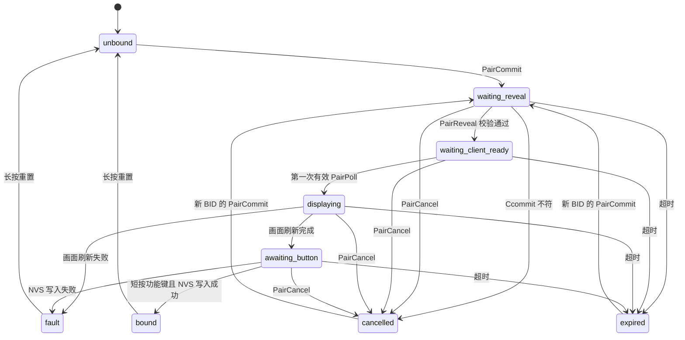

# 配对 v2 规格

这一页是宿主配对协议（op 18–23）的字节级规格：编码约定、每个命令的请求和回复、密钥派生、状态机、时间限制，以及长按重置时宿主做了什么。实现在 `main/pairing.c`（状态机和密码学）、`main/app_pairing.c`（与 App Manager 和屏幕的衔接）、`main/pairing_store.c`（NVS 存储）。

配对的原理、完整流程图和用户操作步骤见 [蓝牙通信](https://github.com/M1nt-Ch0c0/esp32s3/blob/main/docs/06-bluetooth.md#4-配对-v2)。分片写入、签名会话和其他命令见 [宿主蓝牙线上协议](ble-protocol.md)。

## 概要

- 配对由宿主负责：配对画面、功能键（GPIO4）确认、NVS 里的主人记录都属于宿主。应用拿不到任何配对密钥。
- 相框同一时间只认一个主人。换主人只能在相框上长按功能键重置。
- 配对通过 P-256 ECDH 得到双方共享的根密钥 `root`，双方各自从同一份通信记录算出六位码，用户核对一致后短按功能键批准。
- 以后每次连接，客户端用 `root` 做 BondAuth（op 23），得到本次连接的会话密钥。
- 旧的固定令牌鉴权（op 1）总是被拒绝。

## 编码约定

所有整数是无符号小端序，域名字符串按 ASCII 拼接、不带 NUL。

| 符号 | 含义 |
|---|---|
| `V` | 协议版本字节 `0x02` |
| `D` | 6 字节设备 ID |
| `CID` | 客户端身份，16 字节随机非零值，由客户端生成 |
| `BID` | 关系身份，16 字节非零值。新配对时必须等于本次连接 Challenge 的前 16 字节 |
| `Cpub`、`Spub` | 客户端、相框的 P-256 公钥，65 字节未压缩格式，以 `0x04` 开头 |
| `Cnonce`、`Snonce` | 32 字节随机数 |
| `N`、`L` | 客户端名称和它的长度字节。名称 1–32 个可打印 ASCII 字符（`0x20`–`0x7e`），首尾不能是空格 |
| `S` | 本次连接的 32 字节 Challenge（特征 `7b9d0003`） |

op 18–23 是“裸”请求：`op` 后面直接跟参数，不带序号和签名。回复以 7 字节头开头：

```
op:u8 | sequence:u32=0 | code:u16
```

`code` 沿用 [错误码](ble-protocol.md#错误码) 表。下文“带 root 签名”的回复，在末尾追加：

```
HMAC(root, "pp-pair-v2/response" || 回复头和负载)
```

长度、回显的 ID、Challenge 或签名任何一项不对的回复，客户端都要当作无效。未签名的回复（包括 PairInfo）不能证明身份或配对成功。

## 命令

| op | 名称 | 请求（`op` 之后） | 成功回复（7 字节头之后） | 回复签名 |
|---:|---|---|---|---|
| 18 | PairInfo | 空 | `2, state, BID:16, CID:16, remaining_ms:u32, L, N` | 无 |
| 19 | PairCommit | `CID:16, BID:16, Ccommit:32, L, N` | `2, BID:16, Spub:65, Scommit:32` | 无 |
| 20 | PairReveal | `BID:16, Cpub:65, Cnonce:32` | `2, BID:16, Snonce:32, state, remaining_ms:u32, S:32` | `root` |
| 21 | PairPoll | `BID:16, proof:32` | `2, BID:16, state, remaining_ms:u32, S:32` | `root` |
| 22 | PairCancel | `BID:16, proof:32` | 同 PairPoll | `root` |
| 23 | BondAuth | `CID:16, BID:16, Cnonce:32, proof:32` | 20 字节发现记录 | 会话密钥，见下文 |

`remaining_ms` 是当前阶段剩余的毫秒数，没有期限时为 0。

**PairInfo（18）**：返回当前状态。已绑定时返回主人的 BID、CID 和名称；有候选时返回候选的；两者都没有时，BID 是 Challenge 前 16 字节，CID 全零，名称为空。

**PairCommit（19）**：开始一次配对。

| 情况 | 结果 |
|---|---|
| 已有主人 | 8 |
| 存储故障 | 10 |
| 参数格式错误、BID 不等于 Challenge 前 16 字节 | 4 |
| 另一个候选正在进行，或距上一次开始不足 60 秒 | 3 |
| 与正在进行的候选完全相同的重复请求 | 返回原来的 `Spub` 和 `Scommit`，不重新生成密钥 |
| 同一 BID 但其他参数不同 | 3 |
| 同一 BID 的候选已经取消或过期 | 11 |

**PairReveal（20）**：客户端揭示公钥和随机数。宿主核对 `Ccommit`，不符时这次配对被取消并返回 1。核对通过后宿主算出 `root` 和六位码，状态变为 `waiting_client_ready`。用同样的参数重复 PairReveal 会得到同样的回复。BID 不对或状态不允许时返回 8。

**PairPoll（21）**：客户端证明自己已经保存了 `root`。状态为 `waiting_client_ready` 时，第一次有效的 PairPoll 让宿主开始显示配对画面。对已绑定的主人，PairPoll 返回 `state=5`。

**PairCancel（22）**：取消自己的候选。对已绑定的关系返回 8。

PairPoll 和 PairCancel 的证明：

```
proof  = HMAC(root, domain || V || D || CID || BID || S)
domain = "pp-pair-v2/poll" 或 "pp-pair-v2/cancel"
```

证明和回复都绑定当前连接的 Challenge，录下来的旧数据不能在新连接上重放。证明不对返回 1。

## 承诺、密钥与六位码

```
Ccommit = SHA256("pp-pair-v2/client-commit" || V || D || CID || BID || Cpub || Cnonce || L || N)
Scommit = SHA256("pp-pair-v2/server-commit" || V || D || CID || BID || Ccommit || Spub || Snonce || L || N)
T       = V || D || CID || BID || Ccommit || Scommit || Cpub || Cnonce || Spub || Snonce || L || N
Z       = P256-ECDH(自己的私钥, 对方公钥)              // 32 字节 x 坐标
salt    = SHA256("pp-pair-v2/salt" || T)
root    = HKDF-SHA256(ikm=Z, salt=salt, info="pp-pair-v2/bond", 长度 32)
code    = LE32(HMAC(root, "pp-pair-v2/code" || T)[0:4]) mod 1000000
```

- 客户端在看到 `Snonce` 之前就承诺了自己的公钥和随机数；宿主在客户端揭示之前就承诺了自己的。双方都必须严格核对对方的承诺。
- 六位码显示为 6 位十进制数，保留前导零。宿主不会在任何公开特征里发送它。
- `tests/ble/pairing-v2.json` 是一组固定输入的测试向量（由独立的 OpenSSL 实现生成），宿主 C 测试和客户端测试都用它核对。

## 状态

| 值 | 名称 | 含义 |
|---:|---|---|
| 0 | `unbound` | 没有主人，可以配对 |
| 1 | `waiting_reveal` | 收到 PairCommit，等 PairReveal |
| 2 | `waiting_client_ready` | 双方都算出了六位码，等第一次 PairPoll |
| 3 | `displaying` | 正在刷新配对画面 |
| 4 | `awaiting_button` | 画面已刷完，等用户短按功能键 |
| 5 | `bound` | 已有主人 |
| 6 | `cancelled` | 本次配对已取消 |
| 7 | `expired` | 本次配对超时 |
| 8 | `fault` | 存储故障，只能长按重置 |



`unbound` 和 `fault` 状态下，任何管理命令都不可用。

## 时间限制

| 阶段 | 限制 |
|---|---|
| `waiting_reveal` | 30 秒 |
| `waiting_client_ready` | 30 秒 |
| `displaying` | 650 秒（与应用显示的预算相同） |
| `awaiting_button` | 画面刷完后 120 秒 |
| 两次不同配对的开始之间 | 至少 60 秒 |

同一时间只有一个候选。连接中途断开时，客户端可以在有效期内用同一个 BID 和 `root` 证明继续。相框重启会丢掉还没批准的候选。取消或过期的 BID 不能再用，新配对要重新连接，拿新的 Challenge。

## 屏幕与按键

- 配对画面通过 App Manager 显示，和应用的显示共用同一个通道。画面显示客户端名称和六位码。
- 画面刷新完成、屏幕断电之后，状态才变成 `awaiting_button`。
- 按下和松开都发生在 `awaiting_button` 内、按住 50–600 毫秒的短按才算批准。画面还在刷新时的按键不算。
- 批准时宿主先把 `CID`、`BID`、`root` 和名称写入 NVS，成功后才变成 `bound`，并显示“已配对”画面。写入失败时变成 `fault`，客户端不会被认可。
- 宿主显示配对画面和等待按键期间，暂停向应用投递事件，结束后恢复。
- 没有主人时，短按只用于确认配对；已绑定后，短按功能键用来切换应用（见 [应用目录与槽位](app-catalog.md#功能键)）。

## 主人记录

主人记录保存在 `nvs` 分区的 `pp_pair` 命名空间，键 `owner`，是一个带版本和摘要的单个 blob。

| 读到的情况 | 结果 |
|---|---|
| 命名空间从未存在 | 未绑定 |
| 有效的未绑定标记 | 未绑定 |
| 有效的主人记录 | 已绑定 |
| 命名空间存在但没有记录、记录损坏、存储无法初始化 | `fault`，只能长按重置 |

NVS 遇到 CRC 损坏的条目时会擦掉它并报告“找不到”，所以“命名空间存在但没有记录”也按故障处理。

整块重写 NVS 分区（例如 `tools/provision.py` 加 `--port`）会清掉主人记录，之后要重新配对。

## 长按重置

按住功能键至少 8 秒再松开，宿主锁存一个重置请求，正在刷屏时也一样。开机时一直按住不算。

1. 宿主立即撤销当前连接的 GATT 和 CoC 授权，并拒绝新的工作和新的显示。
2. 已经开始的刷新继续完成，直到屏幕断电。
3. 传输工作线程结束或取消手头的请求，关闭会话，释放上传缓冲和准入锁，然后确认这次重置。
4. App Manager 取消旧主人排队的作业，写入有效的未绑定标记（不是直接擦除），清掉候选，并显示“可以配对”画面。

正在进行的上传或连续刷屏都挡不住这个操作。每个蓝牙作业都带着发起时的授权代次，在产生副作用之前再核对一次，所以重置之后旧主人排队的作业不会执行。

长按重置只清除配对关系，Wi-Fi 配置、已安装的应用和最后一帧画面的缓存都保留。它不是出厂重置。应用是和宿主共享地址空间的原生代码，重置不能清除已安装应用自身的行为。

## BondAuth（op 23）

已配对的客户端每次连接都这样鉴权：

```
A       = V || D || CID || BID || S || Cnonce
proof   = HMAC(root, "pp-bond-v2/client"  || A)
session = HMAC(root, "pp-bond-v2/session" || A)
```

| 情况 | 结果 |
|---|---|
| 本连接已经尝试过一次 BondAuth，或已经鉴权 | 1 |
| 没有主人，或存储故障 | 2 |
| CID、BID 与主人不符，长度不对，或证明不对 | 1 |
| 成功 | `op=23, sequence=0, code=0`，20 字节发现记录，再加 `HMAC(session, "pp-ble-v1/response" || 回复头和记录)` |

每个 Challenge 只允许一次鉴权尝试，格式错误也算一次，失败后要断开重连。成功后，`session` 就是 [签名请求](ble-protocol.md#签名请求与回复) 里的会话密钥 `K`，CoC 的方向密钥也从它派生。

客户端为未确认的图片事务保存了 BID 时，重连后发现 BID 变了（相框被重置并换了主人），就不能再恢复或重画那次事务。

## 安全边界

- 配对建立的是身份认证和完整性：别人改不了数据，也冒充不了主人。图片、安装包和状态在空中是明文，附近的人能看到内容。
- 设备 ID 固定不变，附近的人可以通过广播长期识别同一台相框。
- 鉴权在应用层完成，不使用操作系统的蓝牙配对（SMP）或链路加密。
- HTTP 只保留 `GET /health`，其他旧控制接口一律返回 410，旧令牌不能绕过长按重置。
